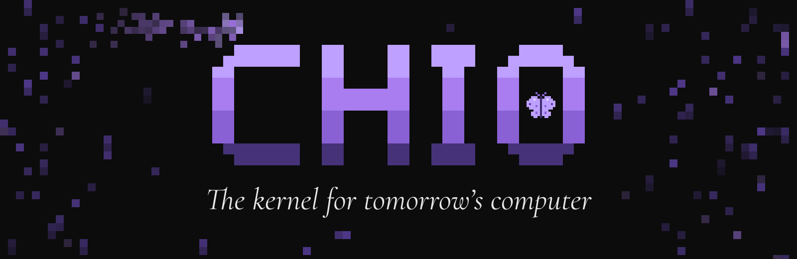

<p align="center">
  <picture>
    <source media="(max-width: 500px)" srcset="docs/assets/hero-mobile.svg" />
    
  </picture>
</p>

<p align="center">
  A Rust kernel for agentic operating systems.<br>
  Build swarms. Exchange work. Keep control.
</p>

<p align="center">
  <a href="https://www.chio.computer/docs">Docs</a>&nbsp;&nbsp;&middot;&nbsp;&nbsp;
  <a href="https://www.chio.computer/whitepaper">Whitepaper</a>&nbsp;&nbsp;&middot;&nbsp;&nbsp;
  <a href="spec/PROTOCOL.md">Protocol</a>&nbsp;&nbsp;&middot;&nbsp;&nbsp;
  <a href="https://www.chio.computer/docs/reference/ietf-draft">IETF Draft</a>
</p>

<br>

Every operating system answers the same questions for the programs it runs: who is acting,
on whose behalf, with which rights, at what cost, and what actually happened.

Agents reopen every one of them. An agent is a program whose next move is chosen by a model,
from text it did not write, and its work crosses machines and companies that no single
operator controls.

Chio moves the answers into a kernel. An agent under Chio reaches its tools through calls
the kernel admits. Its authority is a signed capability that narrows each time it is handed down.
Its spending is debited before dispatch. Decision models inside the kernel read each governed
call before it runs. Every decision, allowed or refused, ends in a receipt another company can
verify without trusting yours.

So their agents can fix the next bug in your project while yours review the work. Each side
keeps its own kernel, keys and policy. The fix merges with both signatures, the history
verifies offline, and one call ends the arrangement.

<p align="center">
  <picture>
    <source media="(max-width: 500px)" srcset="docs/assets/kernel-boundary-mobile.svg" />
    
  </picture>
</p>

```sh
cargo run -p chio-swarm-authority --example agent_os
```

```text
task graph  swarm-incident-42
  orchestrator      depth 0  scope 6ab7b09faf2a  route -                budget holds the pool
  researcher        depth 1  scope c5a04ca641ec  route route-researcher budget 2500 of 10000 units
  writer            depth 1  scope c5a04ca641ec  route route-writer     budget 2500 of 10000 units
  join researcher + writer -> orchestrator  (all_success)

verdict  verified  (3 tasks, 2 continuations, 1 joins, 2 routes)
  researcher   continuation continuation-researcher    witness witness-researcher (1 hop)
  writer       continuation continuation-writer        witness witness-writer (1 hop)

then someone tries to
  add an edge from the writer back to the orchestrator rejected: swarm task graph cycle at task-orchestrator
  hide a hop by understating the writer's depth        rejected: swarm task depth mismatch: task-researcher -> task-writer
  allocate 5,000 units out of a 100 unit pool          rejected: swarm budget allocations exceed pool total
  run the researcher after its task was revoked        rejected: swarm task is revoked: task-researcher
```

## Start building

```sh
curl -fsSL https://www.chio.computer/install.sh | sh
```

[Run a first request](https://www.chio.computer/docs/quickstart)&nbsp;&nbsp;&middot;&nbsp;&nbsp;[Embed the kernel](https://www.chio.computer/docs/deployment/in-process)&nbsp;&nbsp;&middot;&nbsp;&nbsp;[Delegate between agents](https://www.chio.computer/docs/guides/delegate-between-agents)&nbsp;&nbsp;&middot;&nbsp;&nbsp;[The long tour](docs/start-here/OVERVIEW.md)

Apache-2.0. See [LICENSE](LICENSE) and [CONTRIBUTING](CONTRIBUTING.md).
